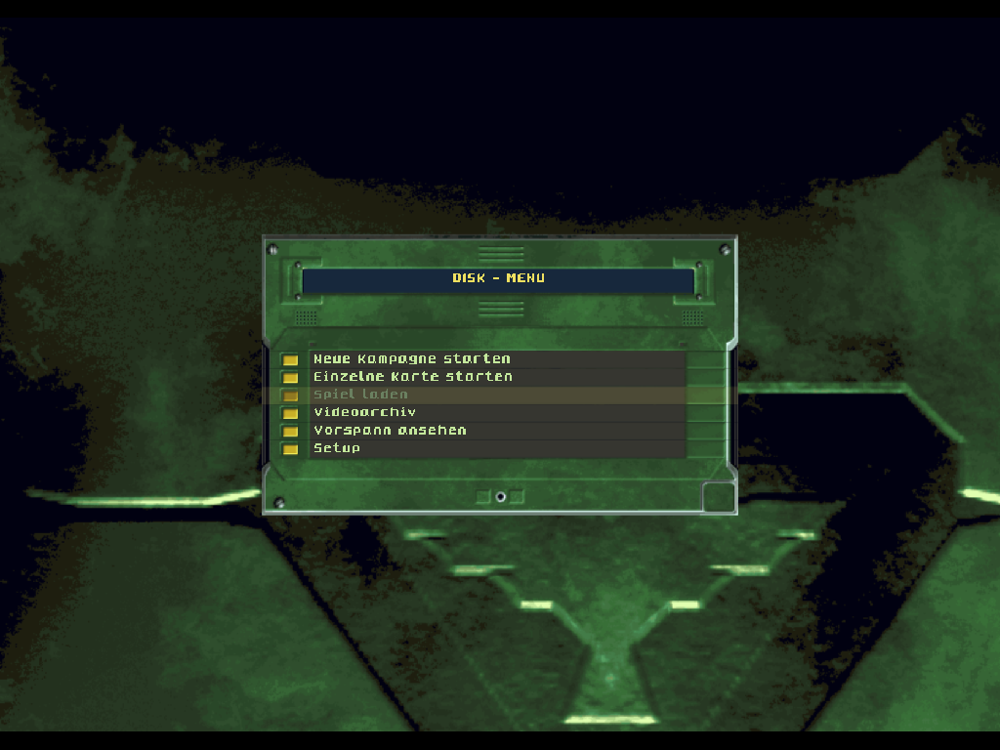
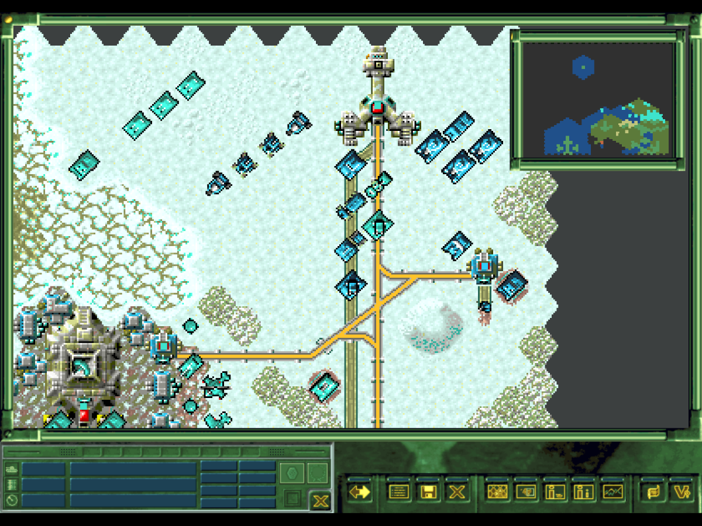
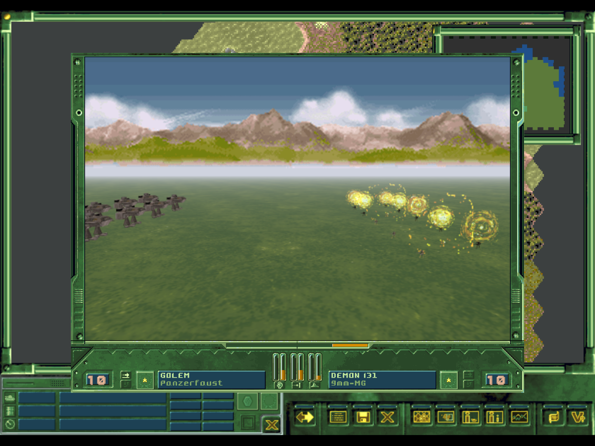
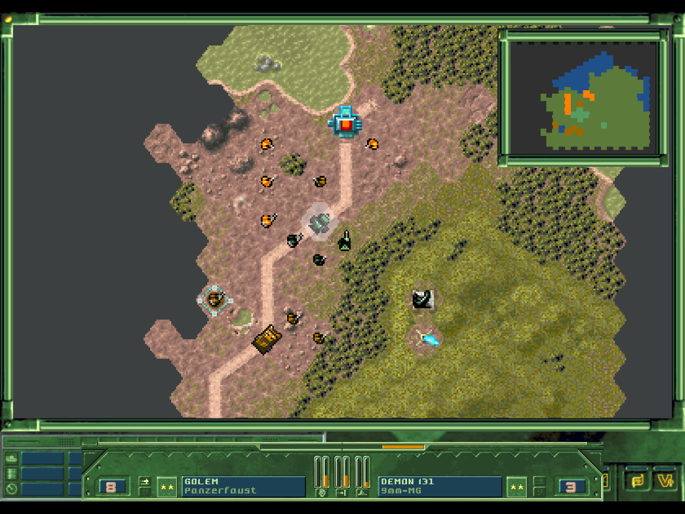
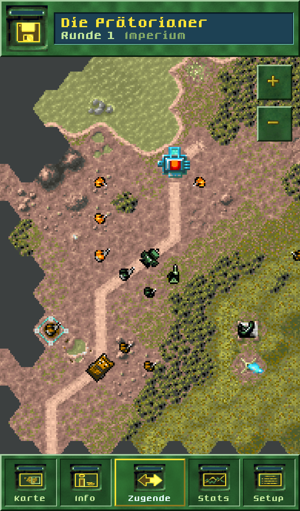

# Battle Isle 3 – Browser-Version

Eine Neuimplementierung von **Battle Isle 3 – Schatten des Imperators** für den Browser (Desktop und Handy). Das Spiel liest die Daten
direkt aus den **eigenen Original-CDs** des Spielers; es sind keine Spieldaten in diesem Repository enthalten und es werden keine
weitergegeben. Ohne die beiden CD-Images startet das Spiel nicht.

| Menü | Karte (Straßen, Schienen, Gebäude) |
|---|---|
|  |  |

| Kampf (3D) | Kampf (Schneller Kampf, Statistik) |
|---|---|
|  |  |

Handy-Oberfläche (wird auf Touch-Geräten automatisch gewählt, im Setup umschaltbar):



## Was drin ist

- Kampagne und Einzelkarten (alle 40 Missionen der drei Battle-Sets), Skripte, Siegbedingungen, Briefings und Videos (in MP4 umgewandelt)
- Spielregeln aus der Original-EXE nachgebaut (Bewegung, Sicht/Nebel, Kampfformel, Erfahrung, Klemmen, Hinterhalt im Nebel, Produktion, Allianzen)
- Original-Grafik: Karten-Kacheln mit nachbarabhängigen Straßen/Wegen/Gräben/Schienen, Einheiten, Fenster, Schriften
- 3D-Kampf mit den Original-3DO2-Modellen (Software-Renderer, Texturen, Kameras) und der Kampfstatistik des Originals (MS_FIGTR.DLL)
- Musik (MIDI-Wiedergabe wie im Original), Kampfgeräusche, Speicherstände im Browser, Autosave
- Desktop-Oberfläche im Stil des Originals und eine eigene Handy-Oberfläche
- Computergegner: **eigene Implementierung**, nicht die Original-KI (diese ist nicht nachgebaut)

## Starten

Gebraucht werden die beiden Original-CDs von Battle Isle 3 als `.iso`-Dateien.

**Fertige Pakete** (siehe [docs/BUILD.md](docs/BUILD.md)): Beim ersten Start nur die beiden ISO-Images übergeben; die Einrichtung übernimmt
die Daten und wandelt die Videos automatisch um. Windows: `BattleIsle3.bat` (portable, alles enthalten). Docker: `docker compose up -d --build`.

**Aus dem Quelltext** (Node 24):

```
npm install
npm run import-cd -- --cd1 <CD1.iso> --cd2 <CD2.iso>   # kopiert die Daten nach public/gamedata, wandelt Videos (FFmpeg nötig)
npm run dev                                              # http://localhost:5173
```

Pakete bauen: `.\build.ps1` (Windows) oder `npm run dist`.

## Tests

```
npm test            # Unit-Tests (Formate, Regeln, Kampf, 3D, MIDI, Straßen)
npm run test:e2e    # Playwright: Missionen, Videos, Musik, Kampf, Speichern, Handy
```

Tests, die Spieldaten brauchen, werden ohne importierte Daten übersprungen.

## Aufbau und Dokumentation

- `src/formats` – Parser der Originalformate (LIB/TPWM, Missionen, 3DO2, MIDI …)
- `src/engine` – Spielregeln und KI, ohne Browser-Abhängigkeit
- `src/render`, `src/ui` – Karte, 3D-Kampf, Fenster, Handy-Oberfläche
- `tools` – Importer, Build-Skripte, Analysewerkzeuge
- [docs/research](docs/research) – ermittelte Regeln und Formate ([Spielregeln](docs/research/GAME_RULES.md), [3DO2](docs/research/FORMAT_3DO2.md),
  [Fenster](docs/research/UI_WINDOWS.md), [Quellen](docs/research/EXTERNAL_SOURCES.md)), [Kampagnenprüfung](docs/testing/CAMPAIGN_VALIDATION.md)

## Rechtliches

Battle Isle ist eine Marke der jeweiligen Rechteinhaber. Dieses Projekt ist ein nicht-kommerzielles Hobbyprojekt ohne Verbindung zu ihnen.
Die Screenshots zeigen Grafiken des Originalspiels und dienen nur der Dokumentation. Spieldaten (CD-Inhalte, daraus erzeugte Dateien) dürfen nicht
weitergegeben werden und sind per `.gitignore` ausgeschlossen. Für die Regeln wurden unter anderem das Open-Source-Projekt BattleIsle2020 (GPLv3)
und die Original-Programmdateien analysiert (siehe [Quellen](docs/research/EXTERNAL_SOURCES.md)).
